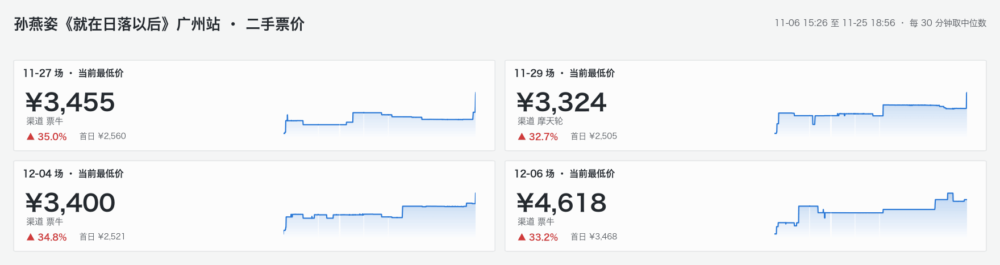
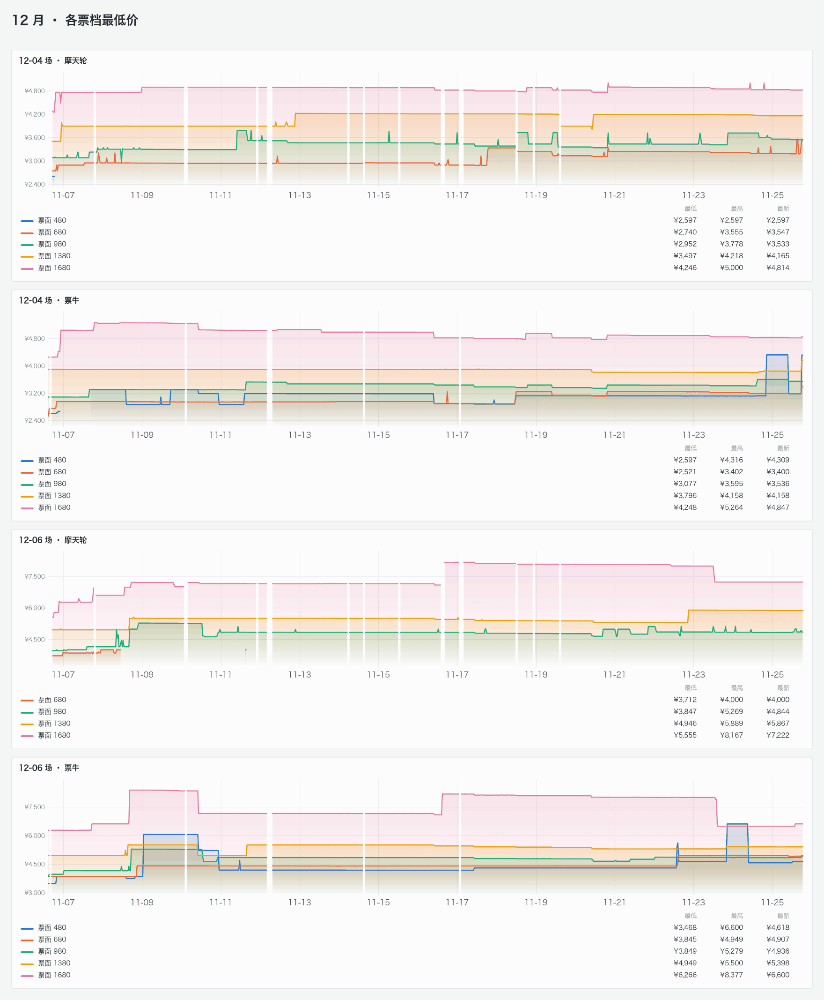
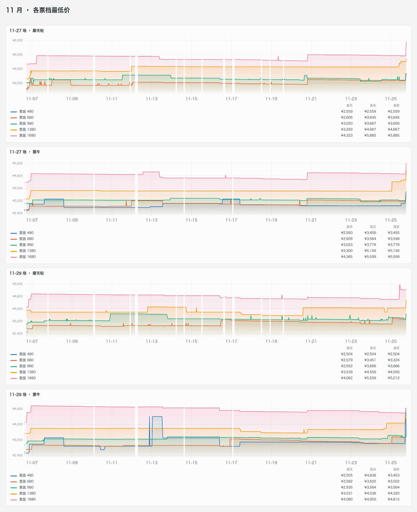
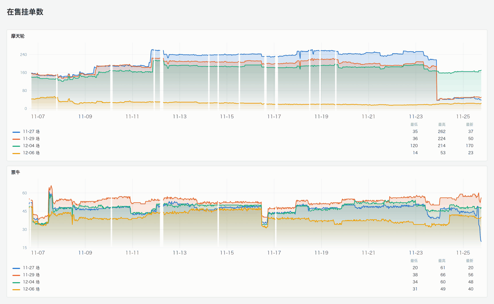

# AUT NIHILO

**孙燕姿《就在日落以后》巡回演唱会**

## 演出

| 城市 | 场馆                         | 场次                                             |
|------|------------------------------|--------------------------------------------------|
| 长沙 | 长沙贺龙体育中心体育场       | 11 月 6 日、11 月 8 日                           |
| 广州 | 广东省奥林匹克体育中心体育场 | 11 月 27 日、11 月 29 日、12 月 4 日、12 月 6 日 |

## 价格走势

<picture>
  <source media="(prefers-color-scheme: dark)" srcset="assets/dashboard-summary-dark.png">
  
</picture>

<picture>
  <source media="(prefers-color-scheme: dark)" srcset="assets/dashboard-12-dark.png">
  
</picture>

<picture>
  <source media="(prefers-color-scheme: dark)" srcset="assets/dashboard-11-dark.png">
  
</picture>

<picture>
  <source media="(prefers-color-scheme: dark)" srcset="assets/dashboard-listings-dark.png">
  
</picture>
